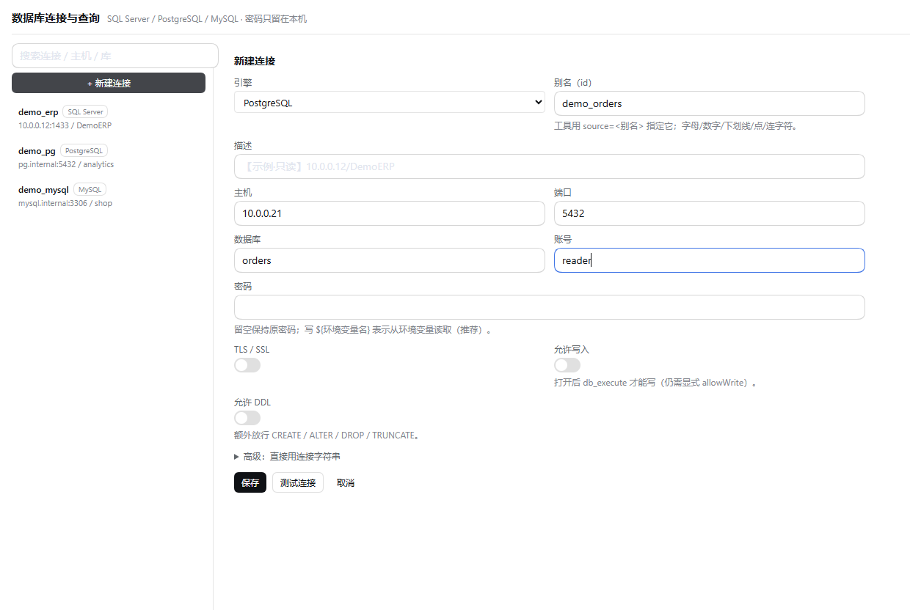

# dsh-tool-database

DeepSeek Harness 的**数据库原生工具插件**：一套工具同时连 **SQL Server / PostgreSQL / MySQL**，
模型直接读（可选写）你配置的库，**不经过 MCP、不 spawn 外部进程**；左侧栏还有「数据库」面板，
左边管连接、右边直接跑 SQL 看结果。

> 前身是 `dsh-tool-mssql`（只能连 SQL Server，所以名字里带 mssql）。0.2.0 起改成多引擎，
> 包名与工具前缀一起换成 `dsh-tool-database` / `db_*`——名字不再绑定某一种数据库。
>
> 骨架来自 [WODE25500/dsh-tool-sqlite](https://github.com/WODE25500/dsh-tool-sqlite)：去掉 SQLite 工作区语义，
> 换成官方驱动 + 多数据源 + 凭据边界。定位是**替代 dbhub 这类 MCP 那一层**：连接与凭据留在宿主侧，
> 模型只看到源句柄与数据。

## 支持的引擎

| 引擎 | `engine` | 驱动 | 默认端口 | DSN 前缀 |
| --- | --- | --- | --- | --- |
| SQL Server | `sqlserver`（默认，兼容老清单） | `mssql`（tedious） | 1433 | `sqlserver://` / `mssql://` / `tds://` |
| PostgreSQL | `postgres` | `pg` | 5432 | `postgres://` / `postgresql://` / `pg://` |
| MySQL / MariaDB | `mysql` | `mysql2` | 3306 | `mysql://` |

每个源独立选引擎；同一个插件里可以同时放 SQL Server 生产库、PostgreSQL 报表库、MySQL 业务库。

## 相比 dbhub MCP 的差异

| | dbhub MCP | 本插件 |
| --- | --- | --- |
| 运行形态 | 宿主 spawn 一个子进程，stdio 通信 | 进程内 host 插件，无子进程 |
| 启动依赖 | 首次可能要 `npx` 联网解析包；代理挂了会反复重连直到工具被注销 | 纯本地依赖，无网络解析 |
| 凭据位置 | 明文写在 `dbhub.toml` 的 DSN 里 | `passwordEnv` 环境变量优先；模型永远看不到密码 |
| 支持的库 | 多种（各自配置） | SQL Server / PostgreSQL / MySQL |
| 工具数量 | 每个源 × 每个 tool 一组 | 恒定 6 个，源再多也不膨胀上下文 |
| 只读护栏 | 靠 `[[tools]] readonly` 关键字过滤 | 语句白名单 + 单语句判定 + 写通道双闸门 |

## 注册工具

| 工具 | 功能 |
| --- | --- |
| `db_sources` | 列出已配置的源（id / 引擎 / 主机 / 端口 / 库 / 账号 / 是否可写），可 `probe: true` 实测连通性 |
| `db_databases` | 列出该实例上的数据库（SQL Server `sys.databases` / PostgreSQL `pg_database` / MySQL `SHOW DATABASES`） |
| `db_tables` | 列出表与视图（schema / 类型 / 行数估算），支持 `schema` / `filter` 过滤 |
| `db_schema` | 单表列结构：类型（带长度精度）/ 可空 / 自增 / 主键 / 默认值 |
| `db_query` | **只读**查询，单条语句，参数绑定，返回 `{ columns, rows, truncated, rowCount, elapsedMs }` |
| `db_execute` | **写**通道，需源开启 `writable` **且**显式 `allowWrite: true`；DDL 另需 `allowDdl` |

> 省 token 工作流：`db_sources` → `db_tables filter:` → `db_schema` → `db_query`。先看结构再取数，避免 `SELECT *` 全表灌进上下文。

参数占位按引擎走：SQL Server 用 `@p0, @p1 …`；PostgreSQL 用 `$1, $2 …`；MySQL 用 `?`，值都放 `params` 数组。

## 左侧栏「数据库」面板（0.2.1 起在左侧栏，0.2.0 曾在会话标签页）

左侧栏全局面板区多一个 **数据库**（挨着「插件 / 自动化任务」），点开就是：

- **左栏**：连接列表（搜索、引擎徽标、可写标记），点一条即在右侧打开；
- **右栏 · 查询**：SQL 输入框 + 「执行」（Ctrl / Cmd + Enter），结果表格显示列名、行数、耗时，超限标「已截断」；
- **右栏 · 连接表单**：新建 / 编辑连接用表单填（引擎、主机、端口、库、账号、密码、TLS、可写、允许 DDL），
  「测试连接」当场试连；连接字符串收在「高级」里，不想填字段时再展开。




设置页里只留「数据库连接」一节：控制台的**写策略**与默认行数。


所有改动都写回宿主侧清单文件（临时文件 + rename），宿主按 mtime 热加载，**不用重启**。

## 安装

已发布到 npm：**`dsh-tool-database`**（源码仓库：https://github.com/SouleyMoni1/dsh-tool-database ）。

### Web profile

```bash
dsh plugin --profile web add dsh-tool-database@0.2.0
```

> 建议带上显式版本号：npm 上还留着一个早期占位版本 `0.0.0-stage`（tarball 已损坏，删不掉），
> 不带版本号时 pnpm 有机会解析到它并报 `ERR_PNPM_TARBALL_EXTRACT`。

### 桌面端（desktop profile，由 Electron 应用独占管理）

`dsh plugin --profile desktop ...` 会被 CLI 直接拒绝：
`profile "desktop" is managed exclusively by the Electron application`。
桌面端要么走市场面板装 npm 上的包，要么手工做一遍 CLI 的等价操作：

1. `~/.dsh/profiles/desktop/package.json` 的 `dependencies` 加 `"dsh-tool-database": "^0.2.0"`；
2. 同一文件的 `dsh.profile.bundles` 数组加 `"dsh-tool-database"`；
3. 在 profile 目录里用**与该 profile 同大版本**的 pnpm 执行安装，然后重启 DSH：
   桌面 profile 当前是 pnpm `11.28.5`（store 在 `~/AppData/Local/pnpm/store/v11`），
   用 v10 会报 “node_modules was installed with a different major version of pnpm”，
   直接 `cd ~/.dsh/profiles/desktop && npx --yes pnpm@11.28.5 add dsh-tool-database@0.2.0` 最稳。

装完**重启 DSH**：6 个工具、侧栏面板、设置页标签都要重启后才出现（`sources.json` 的改动不用重启）。

### 从 dsh-tool-mssql 升级

旧的 `dsh-tool-mssql` 与新的 `dsh-tool-database` **不要同时装**（会同时出现 `mssql_*` 和 `db_*` 两套工具）：

```bash
dsh plugin --profile web remove dsh-tool-mssql
dsh plugin --profile web add dsh-tool-database
```

首次启动会自动把 `$DSH_HOME/mssql-tool/sources.json` 复制到 `$DSH_HOME/database-tool/sources.json`
（只复制不删除，老清单留着随时回退）；老字段 `server` 仍然认，缺省引擎按 `sqlserver` 处理。

### 关于入口 shim（为什么以前装进 profile 会 failed to import）

DSH 0.2.x 的 profile 层解析器（`@deepseek-ai/dsh-app-boot` 的 `ResolutionRouter.routeScoped`）
把 `require('process/')` 归一成裸名 `process` 后直接
`for (const p of createRequire(parent).resolve.paths(name))`；Node 对内建模块名返回 `null`，
这段没有 `?? []` 兜底，于是抛 `TypeError: createRequire.resolve.paths is not a function or its return value is not iterable`。
各数据库驱动的 CJS 依赖链里都有这种写法，插件会在 import 阶段失败，启动日志只有一行
`failed to import`。

0.1.1 起入口改为 `lib/boot.js`：先加载一小段 shim，把内建模块请求直接短路（解析结果与 Node 原生一致），
再动态 import 真正实现，因此**正常装进 profile 即可**。宿主修好这段解析代码后，这层 shim 可以删掉。

### 本地目录安装（开发调试，改代码即时生效）

`link:` 的目标是**相对 profile 目录**解析的：跨盘符直接写 `link:F:\...` 会生成坏联接。
先在 `~/.dsh/profiles` 下建一个指向仓库的目录联接，各 profile 都用相对路径引用：

```bat
mkdir "%USERPROFILE%\.dsh\profiles\.local-links"
mklink /J "%USERPROFILE%\.dsh\profiles\.local-links\dsh-tool-database" "F:\EdenOS\AI\DSH插件\dsh-tool-mssql"
```

`link:` 不跑 `prepack`，装之前先 `npm run build` 出 `lib/`。

```bash
dsh plugin --profile web add "link:../.local-links/dsh-tool-database"
```

## 配置

源清单两种配法，**`config.sources` 非空时优先**：

### 方式一：插件 config（profile 的 cordis.patch.yml）

```yaml
- insert:
    - id: tool-database
      name: 'dsh-tool-database'
      config:
        defaultSource: prod_WMS
        sources:
          - id: prod_WMS
            engine: sqlserver
            description: 【正式·只读】10.0.0.9/demo_erp
            host: 10.0.0.9
            port: 1433
            database: demo_erp
            user: reader
            passwordEnv: MSSQL_PROD_PW
            writable: false
          - id: pg_report
            engine: postgres
            description: 【报表】pg.internal/report
            host: pg.internal
            database: report
            user: readonly
            passwordEnv: PG_REPORT_PW
            ssl: true
```

### 方式二：独立 JSON 文件（推荐，改完即时生效）

`$DSH_HOME/database-tool/sources.json`（默认 `C:\Users\<你>\.dsh\database-tool\sources.json`）：

```json
[
  {
    "id": "prod_WMS",
    "engine": "sqlserver",
    "description": "【正式·只读】10.0.0.9/demo_erp",
    "host": "10.0.0.9",
    "port": 1433,
    "database": "demo_erp",
    "user": "reader",
    "passwordEnv": "MSSQL_PROD_PW",
    "writable": false
  },
  {
    "id": "mysql_shop",
    "engine": "mysql",
    "host": "10.0.0.9",
    "port": 3306,
    "database": "shop",
    "user": "reader",
    "password": "仅本机可见的明文密码",
    "writable": false
  }
]
```

文件按 mtime 热加载：**改完不用重启**，下一次工具调用即生效。插件启动时若清单文件不存在也不报错，只是没有可用源。
日常维护直接用左侧栏的「数据库」面板，不用手写 JSON。

### 字段

| 字段 | 必填 | 说明 |
| --- | --- | --- |
| `id` | ✅ | 源句柄，模型用它在各工具里选库；清单内不可重复 |
| `engine` | | `sqlserver`（默认）/ `postgres` / `mysql` |
| `host` | ✅ | 主机名或 IP（老字段名 `server` 仍然认） |
| `port` | | 默认按引擎：1433 / 5432 / 3306 |
| `database` | | 默认库；不填则由账号默认库决定（MySQL 建议填） |
| `user` | | 登录名 |
| `passwordEnv` | | **推荐**：环境变量名，密码从 `process.env` 取 |
| `password` | | 备选：明文写在配置里（仍只在宿主侧，但会落盘） |
| `writable` | | 默认 `false`。只有 `true` 才允许 `db_execute` |
| `allowDdl` | | 默认 `false`。允许 `CREATE/ALTER/DROP/TRUNCATE` |
| `allowBatch` | | 默认 `false`。写通道允许分号分隔的批量语句 |
| `ssl` | | 默认 `false`。PostgreSQL / MySQL 走 TLS；SQL Server 等价于 `encrypt` |
| `encrypt` | | SQL Server 专用；`ssl: true` 会一起打开 |
| `trustServerCertificate` | | 默认 `true`；云库用自签证书时保留 `true` |
| `requestTimeoutMs` | | 单语句超时，默认 `15000` |

密码用环境变量时要让 DSH 进程能读到（桌面端可在启动前设置系统环境变量，或改用 `password`）。

## 控制台写策略

侧栏「数据库」面板里跑 SQL 时，写语句受两层控制：

1. **控制台写策略**（设置 → 数据库连接，或 `$DSH_HOME/database-tool/config.json` 的 `writeMode`）：
   - `source`（默认）：跟随数据源的 `writable` / `allowDdl`；
   - `readonly`：一律只读，写语句直接拒绝（排查时最稳）；
   - `always`：允许写（仍然要过单语句 / 提权关键字检查）。
2. **数据源开关**：源的 `writable`、`allowDdl`、`allowBatch`。

模型工具 `db_execute` 不受 `writeMode` 影响（它有自己的 `writable` + `allowWrite` 双闸门），
控制台策略只约束人在界面里敲的 SQL。

## 安全模型

- **只读白名单**：只读通道仅放行以 `SELECT` / `WITH` / `VALUES` 开头的语句；
- **危险词拦截**：`SELECT ... INTO`、`EXEC`、`OPENROWSET`、`DBCC`、`WAITFOR`、DDL/DML 关键字直接拒绝
  （判定前先剥离字符串、注释与 `[]` / `""` / 反引号标识符，不会误伤字面量里的关键字）；
- **单语句**：只读通道出现分号分隔的多语句即拒绝；
- **写通道双闸门**：源必须 `writable: true`，调用方还要显式 `allowWrite: true`；DDL 另需源开启 `allowDdl`；
  `xp_*` / `OPENROWSET` / `BACKUP` / `GRANT` 等提权关键字一律拒绝；
- **参数绑定**：`db_query` / `db_execute` 用引擎各自的占位符 + `params` 数组绑定，不做字符串拼接；
- **输出预算**：默认 100 行、硬上限 500 行，超限明确标注 `truncated`；
- **凭据边界**：`db_sources` 只输出「是否已配密码」，不含密码、不含 `passwordEnv` 的取值、不含完整连接串；
  设置页列表里的 DSN 恒为 `******`，只有本机同源、经 DSH 会话鉴权的编辑表单才拿得到明文回填。

## 从 dbhub 迁移

1. 把 `~/.dsh/mcp-servers/dbhub.toml` 里每个 `[[sources]]` 转成一条 `sources.json`：
   `dsn` 里的 `user:password@host:port/database` 拆成 `user` / `passwordEnv`（或 `password`）/ `host` / `port` / `database`，
   按协议补 `engine`；
2. 正式库保留 `writable: false`，开发/测试库按原来的策略设 `writable: true`；
3. **删掉** profile 的 `cordis.patch.yml` 里的 `mcp-dbhub` 条目（否则两套工具并存）；
4. 重启 DSH，用 `db_sources probe: true` 验证连通。

工具名对照：`execute_sql` → `db_query`（读）/ `db_execute`（写）；`search_objects` → `db_tables` + `db_schema`。

## 使用示例

```
db_sources probe: true
db_tables source: "prod_WMS" filter: "Order"
db_schema source: "prod_WMS" table: "dbo.Sys_Log"
db_query source: "prod_WMS" sql: "SELECT TOP 10 Url, CreateTime FROM Sys_Log WHERE CreateTime >= @p0 ORDER BY CreateTime DESC" params: ["2026-01-01"]
db_query source: "pg_report" sql: "SELECT * FROM orders WHERE created_at >= $1 LIMIT 20" params: ["2026-01-01"]
db_query source: "mysql_shop" sql: "SELECT id, name FROM goods WHERE id = ?" params: [42]
```

## 开发

```sh
npm install
npm run check   # typecheck + vitest + tsc 构建
```

- `src/core.ts` —— 纯函数：引擎元数据、源清单校验、类型格式化、凭据解析、路径约定；
- `src/sql-guard.ts` —— 方言无关的 SQL 护栏（白名单 / 单语句 / 写闸门 / 提权禁词，全部可单测）；
- `src/engines/{sqlserver,postgres,mysql}.ts` —— 各引擎适配器（连接、查询、写、元数据）；
- `src/pool.ts` —— 连接池缓存与统一执行层；
- `src/dsn.ts` —— 连接字符串 ⇄ 源配置（三种 scheme + ADO 写法 + 掩码）；
- `src/settings-store.ts` —— `sources.json` / `config.json` 的原子读写、增删改、老清单迁移；
- `src/index.ts` —— 插件入口，注册 6 个工具；
- `src/settings-rpc.ts` —— 面板 / 设置页的宿主侧 RPC（`sources/*` + `query/run` + `console/save`）；
- `client/client.js` —— 浏览器侧单文件客户端（侧栏面板 + 设置页节，无构建步骤）；
- `tests/` —— vitest：SQL 守卫、清单校验、连接字符串、控制台配置、迁移。

## 已知限制

- **写通道默认单条语句**：需要批量脚本时给源开 `allowBatch: true`；
- 元数据查询依赖各引擎的系统目录视图，账号若无元数据可见性权限会返回空列表；
- 连接池按「引擎 + 源 id + 主机 + 端口 + 库 + 账号」缓存，改这几项后要重启 DSH 才换池
  （改 `sources.json` 的密码/开关不影响已建立的池）；
- `ssl: false` 时流量不加密，跨公网请打开 TLS。

## 许可

MIT（继承上游 dsh-tool-sqlite 的 MIT 许可）。
